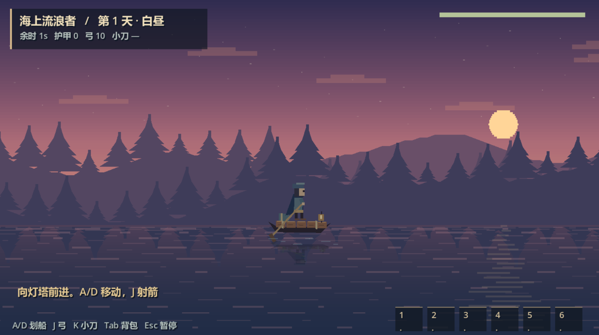
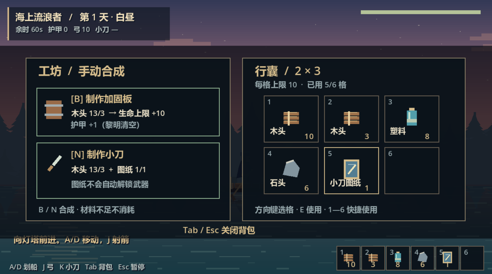

# 海岛~拯救！ / Island Rescue

团队：**XMR（2 人）** · 最新策划：**GDD v0.3（2026-11-12）**

玩家孤身落在一座破岛上，在 10 天内寻找散落的居民、重建三座基地并研究科技。每夜三岛同时受袭：玩家只能亲自守一座，其余岛屿依靠已建防线与驻守居民进行无画面的后台演算。跨岛支援需要乘船，通讯系统提供远端战况与告急信息。

## v0.3 设计方向

- 2D 俯视基地防御、采集建造、居民调度与科技取舍；目标平台为浏览器 WebGL。
- 3 座岛、10 天 10 夜；白天由玩家自主结束。基准单局 20—25 分钟，深度经营约 30—60 分钟。
- 撑过第 10 夜且没有任何岛屿核心被摧毁即获胜；最终各岛核心损伤率均不超过 20% 时进入 HE，否则为 NE。任一岛失守进入 BE；玩家倒地本身不直接判负。
- 木材、石料、食物、研究点四类资源全局共享；居民采用发现与漂流补充的动态池；三支科技共 12 节点。
- 取消旧版“自动防御解锁/评分制”“全岛满级即胜”“延长两天”及跨岛物流运输规则。
- 存档仅在白天进行。部分规则仍标注待确认或待调，以最新策划正文为准。

## 文档与实现状态

- [最新策划方案 v0.3](docs/策划方案.md)：本次上传的最新完整方案。
- [旧版英文策划 v0.2（历史参考）](docs/Design_Plan_EN.md)：不代表 v0.3，尚未翻译新版。
- **现有代码与下载包是初期测试的最小可玩循环**：横版木筏生存原型，验证采集、背包、手动合成、战斗及昼夜流程。它早于 v0.3，尚未实现新版三岛、通讯、居民、科技与存档系统；本次更新策划与项目介绍，不宣称已完成新版玩法。
- 现有 Demo 使用 Godot 4 / GDScript；v0.3 正式版引擎仍待定（Web 原生方案或 Godot 4 Web 导出）。

## 运行早期 Demo

下载并解压 [Godot 工程包](downloads/Sea_Drifter_Demo.zip)，在 Godot 4 中打开 `project.godot`，按 F5。

A/D 或方向键左右移动；J 射箭；K 小刀；Tab 背包；背包中 1—6 使用物资，B 合成加固板，N 合成小刀；Esc 暂停，R 重开。参数位于 `config.json`。当前背包为六格、每格同类物品上限 10，小刀需手动消耗木材与图纸合成。

## 早期 Demo 展示

## 创作说明

本项目由 XMR 自制，参考《王国：两位君主》的美术风格与《星露谷物语》的采集和成长逻辑，结合其设计理念编写自己的策划方案并制作首版最小可玩循环。此前计划于 2026 年 12 月初完成整个游戏的设计。

---

## English Overview

**Island Rescue — XMR (two-person team), GDD v0.3, 2026-11-12.**

Rebuild three island bases, rescue residents and research technologies across ten days and nights. All three islands face simultaneous attacks; the player can personally defend only one. Other islands run headless defense simulations based on their fortifications and garrisons. Boat travel costs time, while communications provide remote warnings.

Survive night ten without losing any island core to win. HE requires every island's final core damage ratio to be at most 20%; otherwise the outcome is NE. Any island falling triggers BE. Player incapacitation alone does not end the run.

Daytime ends at the player's choice. Four shared resources, a dynamic resident pool and twelve technology nodes support strategic choices. The previous defense-score system, maximum-level victory condition, extension days and inter-island logistics have been removed.

The existing Godot code and downloadable build remain an **early minimum playable loop prototype**, with side-view raft survival, inventory, crafting and combat. They do not yet implement the v0.3 full-game design. The Chinese v0.3 plan is authoritative; the separate English v0.2 document is historical.
