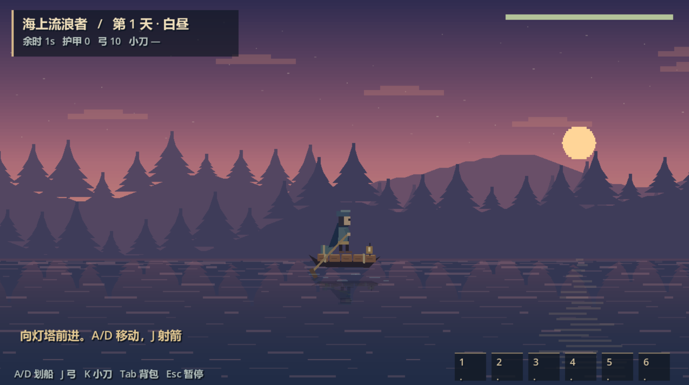
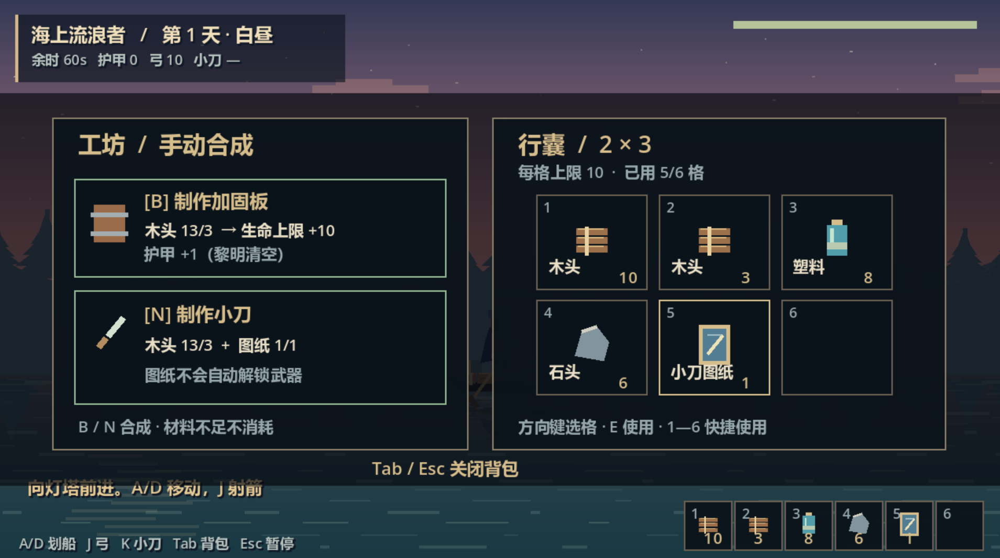

# 海岛~拯救！ / Island Rescue

团队：**XMR（2 人）** · 最新策划：**GDD v0.7（2026-11-22）**

比勒加群岛被万年一遇的风暴重创。玩家作为群岛的开创者与领导者，在 10 天内收集物资、找回幸存居民、重建三座基地，并在夜晚与居民一起抵御深海敌人。多岛同时受袭时，玩家只能亲自站在一座岛上，需要在防线布局、居民驻守与跨岛支援之间取舍。

## v0.7 设计方向

- 2D 俯视塔防 / 策略 / RPG，使用 Godot 4 Web 导出，计划部署于魔搭创空间。
- 10 天 10 夜：白天固定 100 秒、入夜转场 2 秒、夜晚固定 80 秒；基础流程约 30.3 分钟，不含暂停与结算停留。
- 夜晚清空波次后仍可采集、建造和修复，不能提前结束夜晚，也不能在夜间拆除。
- 科技树与居民树各 6 节点，加 3 个协同点；科技路线强化玩家与无人设施，居民路线强化人口与驻守力量。
- 高塔形态由驻守兵种决定，空塔不攻击；后期引入电力容量与高级设施。
- 木、石、铁、食物和研究点全局共享；电力属于设施容量。
- 主岛核心归零或玩家死亡立即失败；副岛在普通夜晚失守后可于白天清剿、修复并收复。第 10 夜任一岛失守则失败。
- 撑过第 10 夜且无岛失守为 NE；最终每座岛的非防御设施损伤率均不超过 20% 为 HE。具体判定与数值以最新策划为准。

## 文档与实现状态

- [最新策划方案 v0.7](docs/策划方案.md)
- [完整英文策划 v0.7](docs/Design_Plan_EN.md)
- **现有代码与下载包仍是初期测试的最小可玩循环**：横版木筏生存原型，验证采集、背包、合成、战斗及昼夜流程，尚未实现 v0.7 的完整三岛设计。本次更新策划与介绍，不修改玩法代码。

## 运行早期 Demo

下载并解压 [Godot 工程包](downloads/Sea_Drifter_Demo.zip)，在 Godot 4 中打开 `project.godot`，按 F5。

A/D 或方向键左右移动；J 射箭；K 小刀；Tab 背包；背包中 1—6 使用物资，B 合成加固板，N 合成小刀；Esc 暂停，R 重开。参数位于 `config.json`。当前背包为六格、每格同类物品上限 10，小刀需手动消耗木材与图纸合成。

## 早期 Demo 展示

## 创作说明

本项目由 XMR 自制，参考《王国：两位君主》的美术风格与《星露谷物语》的采集和成长逻辑，结合其设计理念编写自己的策划方案并制作首版最小可玩循环。此前计划于 2026 年 12 月初完成整个游戏的设计。

---

## English Overview

**Island Rescue — XMR (two-person team), GDD v0.7, 2026-11-22.**

Rebuild the storm-struck Bilega archipelago over ten days and nights. Gather supplies, rescue residents and defend three island bases against deep-sea enemies. The player can personally occupy only one island while the others continue their defense simulation.

The planned game is a top-down tower-defense / strategy / light RPG built with Godot 4 Web export for ModelScope Spaces. Each day lasts 100 seconds, followed by a 2-second transition and an 80-second night, for approximately 30.3 minutes before pauses and results screens. Clearing waves does not end the night early.

Technology and resident trees each have six nodes plus three synergy points. Garrisoned units determine tower forms; empty towers cannot attack. Later facilities use electricity capacity. Resources include wood, stone, iron, food and research points.

Player death or destruction of the main core causes defeat. Secondary islands lost before the final night can be reclaimed. Any island lost on night ten causes defeat. Surviving the final night wins; HE additionally requires each island's non-defensive structures to have no more than 20% damage at the final assessment.

The existing code and downloadable build remain an early side-view raft prototype, not an implementation of the full v0.7 design. The complete v0.7 design plan is available in [Chinese](docs/策划方案.md) and [English](docs/Design_Plan_EN.md).
