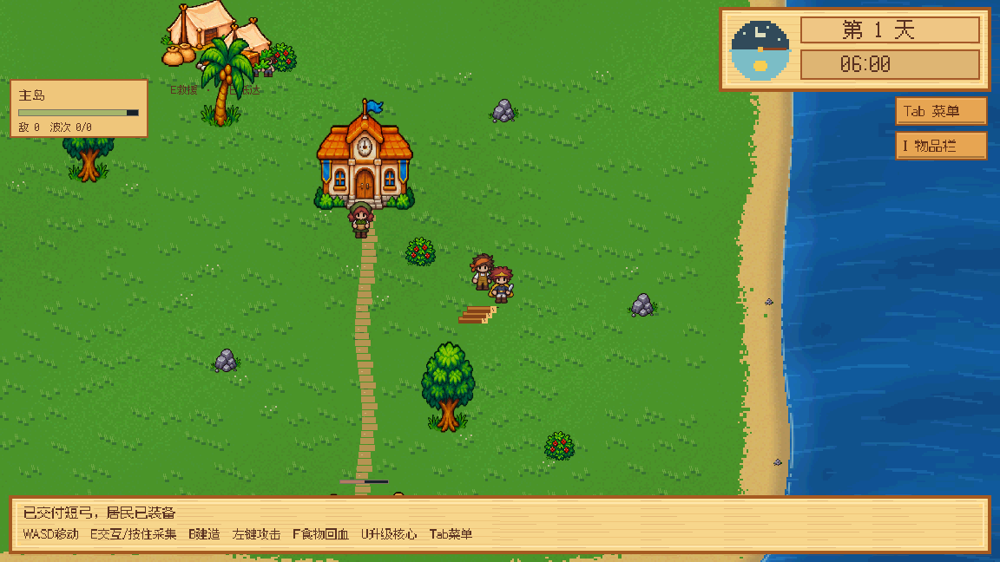
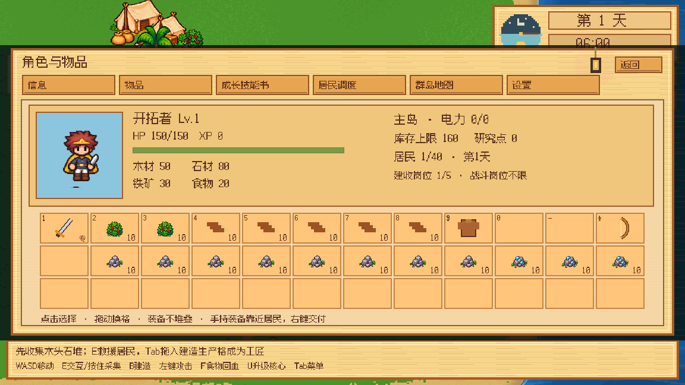

# 海岛～拯救！ v0.0.5

用 Godot 4.7.2 打开本目录的 `project.godot`，按 F5 启动游戏。Web 构建可通过 HTTP 服务打开 `Web/game.html`。

- [最终版策划案（中文）](GDD.zh-CN.md) · [Final Design (English)](GDD.en.md)
- [原始策划案 GDD v0.9](GDD_v0.9.md)
- [当前规则与最新变更](变更说明_v0.0.5_岗位与物品栏.md)
- [角色、怪物、环境美术图集](assets/art/)
- [新版游戏主界面](previews/38-header-removed.png) · [新版角色与物品栏](previews/34-inventory-information.png)
- [程序与 Shader](scripts/) · [现行界面约定](UI约定.md)

仓库中的 references 开头的 HTML 是历史交互原型。运行当前游戏请使用本页顶部的 Godot 工程或 Web 构建。
