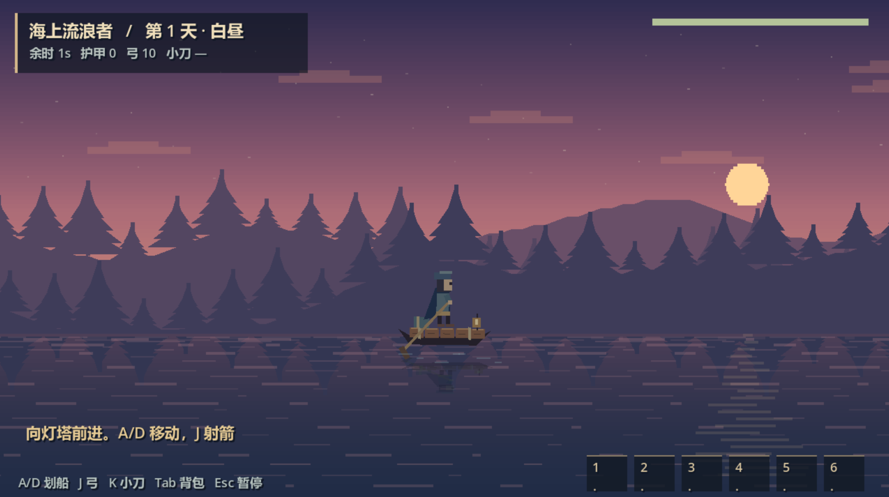
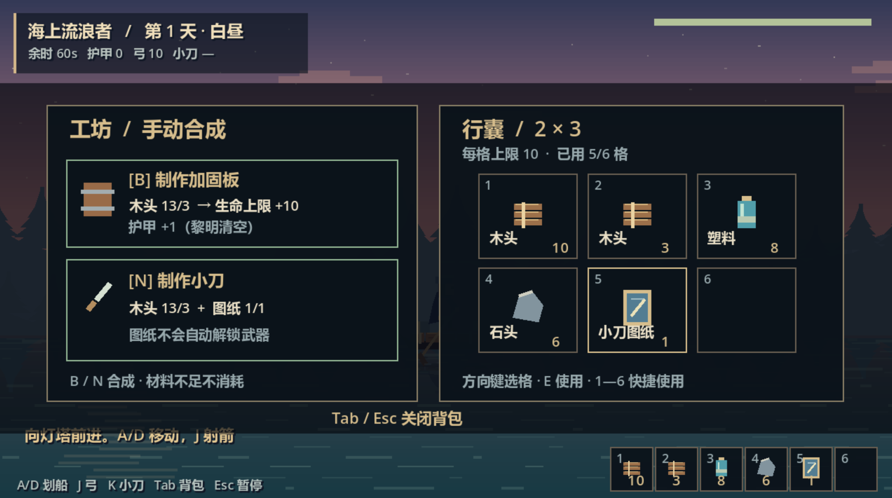

# Game Design Document (GDD) v0.2 — [Game Title]

**Version:** v0.2  
**Date:** 2026-11-08  
**Author / Team:** XMR  

**Creative statement:** Drawing inspiration from the art style of Kingdom Two Crowns and the gameplay logic of Stardew Valley, we combined their design philosophies and artistic influences to develop our own design plan and build the first minimum playable loop. We expect to complete the design of the entire game in early December 2026.
**Competition:** AI Game Creation Competition  
**Purpose:** Team alignment, constraints for AI-generated specifications, scope control, and submission documentation.

---

## 0. One-Page Summary

- **Pitch:** Within 10 days, gather resources, build, assign residents, choose technologies, and explore and upgrade three islands to rebuild their bases. Defend against enemies at night through active combat or automatic defense, ultimately maximizing every island and meeting its automatic-defense requirements.
- **Genre:** Short-session base defense / gathering and construction / resident assignment / technology trade-offs.
- **Platforms:** WebGL / Windows, subject to competition requirements.
- **Target session length:** 30–45 minutes; 10 days lasting 4–6 minutes each. Players may end daytime early.
- **Core experience:** Long-term technology planning versus immediate resident assignment; production versus defense; active versus automatic defense, balancing costs and resident trust.
- **Competition scope:** Three islands; main island levels 1–4; secondary islands unlocked at level 1 and upgraded to level 2; 10 days plus up to 2 extension days; three resident categories; three technology branches; automatic defense unlocked in the middle or late game.
- **Out of scope:** Resident affection, needs or death; complex story; weather; simultaneous real-time nighttime control on multiple islands; open world; complex technology trees.

## 1. Project Information and Rule Constraints

- Competition deadline / time zone:
- Must development start from scratch?
- Engine, asset and plugin licensing restrictions:
- Deliverables: Playable link or build, cover image, screenshots, controls, demonstration video, AI-use disclosure, and competition concept-post link.
- Judging criteria:
- Public concept-post link:
- Compliance risks:

**Acceptance criteria:** Confirm all rules and assign an owner to each required deliverable.

## 2. Concept and Positioning

### 2.1 Setting and Theme
- One-sentence setting:
- Connection to the competition theme:

### 2.2 Player Fantasy
- Role: Commander and protector overseeing base reconstruction.
- Desired feeling: Make trade-offs under time pressure and watch ruined islands develop into fully upgraded, automatically defended settlements.
- Inspirations: Stardew Valley for gathering and short progression loops; Kingdom Two Crowns for base expansion and wave defense.

### 2.3 Design Pillars
1. Prepare by day and defend by night, with a clear rhythm.
2. Balance long-term technology planning with immediate resident assignment.
3. Require trade-offs between production and defense.
4. Active defense earns more trust; automatic defense reduces input but introduces upkeep and risk.
5. Show visible growth on every island, culminating in maximum levels and adequate automatic defense.

### 2.4 Anti-Pillars
- No resident affection, needs or death.
- No simultaneous real-time nighttime control across multiple islands.
- No complex story or open world.
- No new systems after week 3.

### 2.5 Strategic Focus and Specialization
Players may shift between technology, resident and mixed strategies, at a cost.

- **Technology focus:** Research speed +20%; stronger automated gathering; resident defense efficiency -15%; greater reliance on structures and player combat at night.
- **Resident focus:** Resident gathering and defense efficiency +20%; research speed -15%; slower technology unlocks.
- **Mixed:** No specialization bonus, but fewer weaknesses and greater tolerance for mistakes.
- **All-in limits:** Pure technology and pure resident strategies should both be viable but less forgiving, requiring better research order, assignments and building layouts. Do not hard-lock either route.

## 3. Core Gameplay Loop

### 3.1 Core Loop
Gather during the day → assign residents → choose research, construction or exploration → receive dusk warnings → defend actively or automatically at night → resolve results → start the next day.

### 3.2 Loop Breakdown

| Phase | Player actions | System feedback | Duration |
| --- | --- | --- | --- |
| Day | Gather, build, assign residents, choose technologies, switch islands | Resource and research changes; resident work feedback | 2–3 minutes |
| Dusk | Review threats; make final resident and defense adjustments | Warning UI and audio | 20–30 seconds |
| Night | Active defense or automatic resolution; towers attack and residents assist | Hits, kills, base HP and upkeep use | 1–2 minutes |
| Results | Review losses, resident status, research and upkeep | Results panel | 20 seconds |

### 3.3 Victory and Defeat
- **Immediate victory:** All islands reach maximum level and meet automatic-defense requirements: main island level 4 and both secondary islands level 2.
- **Day 10 results:** If immediate victory has not occurred, grant 2 extension days only if the main island is fully upgraded and meets automatic-defense requirements, and every secondary island is at least level 1. Otherwise, the player loses.
- **Extension:** Stronger waves; upgrades and automatic-defense construction remain available. Failure to meet all requirements by the end results in defeat.
- **Defeat:** Main-island core HP reaches zero, or the extension ends without all islands fully upgraded and meeting automatic-defense requirements.
- **Restart:** One-click restart after victory or defeat.

## 4. Session Flow and State Machine

States: `Day → Dusk → Night → Result → NextDay / GameOver / Victory / Extension`

| State | Entry | Main behavior | Exit |
| --- | --- | --- | --- |
| Day | New day begins | Gathering, building, assignments, research, island travel | Timer expires or player ends day |
| Dusk | Day ends | Show waves, directions and automatic-defense estimate | Countdown ends |
| Night | Dusk ends | Active combat or automatic resolution | Waves cleared or base destroyed |
| Result | Night ends | Resolve resources, upkeep and residents | Player confirms |
| NextDay | Results confirmed | Increment day | Enter Day |
| Extension | Day 10 extension conditions met without victory | Add 2 days with stronger waves | Victory requirements met or extension expires |
| GameOver | Main core HP reaches zero or extension fails | Defeat panel | Restart |
| Victory | All islands maxed and automatic defense adequate | Victory panel | Restart / exit |

## 5. System Design

### 5.1 Player and Interaction
- Movement:
- Gathering:
- Attacking:
- Building / demolition:
- Interaction prompts:
- Player HP / death rules:
- Tutorial: For the first two nights, disable resident active skills and automated assignments; the player gathers, builds and fights manually. Enable resident jobs and skills from day 3.

### 5.2 Resources and Inventory
- Resources: Wood, stone, food, research points and maintenance resources.
- Sources: Gathering, resident jobs, island specialties and technology bonuses.
- Uses: Construction, upgrades, resident upkeep, automatic-defense upkeep and repairs.
- Capacity: Small inventory limits force choices.
- Distribution: Nearby deposits are safer but smaller; distant deposits are richer but riskier.

### 5.3 Construction

| Building | Cost | HP | Function | Upgrade |
| --- | --- | --- | --- | --- |
| Base core | Cannot be built | 100 | Destruction causes defeat | With base level |
| Wall | 10 wood | 50 | Blocks enemies | Level 2 |
| Tower | 20 wood + 10 stone | 60 | Automatic targeting | Level 2 |
| Barricade | 5 wood | 30 | Slows / blocks enemies | None |
| Resident workplace | 15 wood | 40 | Assigned resident post | None |
| Technology / civic building | 20 wood + 10 stone | 50 | Research / trust / transport | None |

- Placement: Grid / snapping with invalid-position feedback.
- Demolition refunds:
- Construction feedback:

### 5.4 Enemies and Waves

| Enemy | HP | Damage | Speed | Behavior |
| --- | --- | --- | --- | --- |
| Standard | 30 | 5 | Medium | Approaches base; attacks walls in its path |
| Fast | 20 | 4 | High | Prioritizes flanking / rushing the base |
| Tank | 80 | 10 | Low | Attacks structures |
| Elite | 150 | 15 | Medium | Appears after night 5; requires additional automatic-defense score |

- Spawns: 1–2 fixed entrances per island.
- Pathfinding: Waypoints and attacks against obstructions; no complex A* in the first version.
- Waves: Very weak on nights 1–2; increase from day 3; substantially stronger on day 10 and during the extension.

### 5.5 Combat and Defense
- Towers: Range, attack speed, damage and targeting priorities.
- Player: Melee / ranged attacks, cooldowns and hit feedback.
- Walls: Damage, destruction and repairs.
- Combat residents: Assigned posts, automatic attacks and active skills.
- Feedback: Damage numbers, hit effects, audio and red flashes when the base is hit.

### 5.6 UI and Feedback
- Resource bar, day / phase, base HP, wave countdown and enemy direction.
- Building menu, resident panel, technology tree, island switching and automatic-defense estimate.
- Resident reminders identify missing maintenance resources and structures needing manual repair.
- Red hit flashes, tower attack lines, construction success / failure messages and end-of-game results.
- Minimal tutorial: Arrows guide gathering, construction and combat during the first two nights.

### 5.7 Residents
**Categories:** Resource gathering, construction / production, combat.  
**Progression:** Resident level is represented by trust / proficiency; no separate level system.  
**Unlocks:** Initially only construction / production residents on the main island. A boat and first secondary island unlock on day 3, adding one category. Unlock all categories by days 4–5.  
**Suggested competition roster:** Six residents, two per category [TBC].  
**Jobs:** Gathering, research, defense, construction / repair and automatic-defense garrison duty.  
**Rules:** Automatic work; one passive and one active skill each; injuries recover the next day; no death; daily food upkeep.

| Resident | Category | Passive | Active skill | Upkeep |
| --- | --- | --- | --- | --- |
| Builder | Construction / production | Construction cost -10% | Quickly repair a wall segment | 1 food/day |
| Artisan | Construction / production | Upgrade speed +10% | Temporary construction speed boost | 1 food/day |
| Gatherer | Resource gathering | Wood / stone +20% | Temporary gathering speed boost | 1 food/day |
| Researcher | Gathering / civic | Research points +1/day | Instantly complete 10% of current research | 1 food/day |
| Guard | Combat | Automatic nighttime attacks | Temporarily increase nearby tower attack speed | 1 food/day |
| Warrior | Combat | Damage against elites +15% | Brief taunt / knockback | 1 food/day |

- Islands without the player: Residents resolve nighttime defense automatically. Before automatic defense is unlocked, use basic-guard resolution with high risk.
- Trust increases through assigned work, civic buildings, active defense and technologies; it affects efficiency, skills and automatic-defense score.

### 5.8 Technology
**Branches:** Combat, resource acquisition, and civic development (trust buildings and inter-island transport).  
**Competition nodes:** 9–12 nodes; 3–4 per branch and 2 cross-branch nodes.  
**Research:** Costs research points and daytime; some nodes require a corresponding resident job.

| Branch | Example node | Effect | Prerequisite |
| --- | --- | --- | --- |
| Combat | Tower Upgrade I | Tower damage +20% | None |
| Combat | Early Warning | More wave information at dusk | None |
| Combat | Automatic Defense Protocol | Unlock defense scoring and resolution | Main island level 3 + civic prerequisite |
| Resources | Automated Gathering I | Resident gathering +15% | None |
| Resources | Research Acceleration | Research speed +20% | Automated Gathering I |
| Resources | Storage Capacity | Inventory +50 | None |
| Civic | Trust Building | Trust gain +20% | None |
| Civic | Transport Scheduling | Island travel time -30%; transport capacity +20% | None |
| Civic | Maintenance Optimization | Automatic-defense upkeep -15% | Transport Scheduling |
| Cross-branch | Resident Research Station | Researcher research points +1/day | Researcher post |
| Cross-branch | Defense Coordination | Guard skill cooldown -20% | Guard post |
| Cross-branch | All-Island Protocol | Automatic-defense score +10% | Automatic Defense Protocol + Trust Building |

- Technology-only: Fast research, weak defense; buildings and player actions must compensate.
- Resident-only: Strong gathering / defense, slow research and later automatic-defense unlock.
- Mixed: Most stable, but lower ceiling.

### 5.9 Islands and Base Reconstruction

| Island | Base levels | Resources | Resident unlock | Threat | Unlock |
| --- | --- | --- | --- | --- | --- |
| Main | 1–4 | Wood / stone | Construction / production | Nightly waves | Initially |
| Secondary A | 1–2 | Food / research points | Gathering or combat | From night 3 | Boat on day 3 |
| Secondary B | 1–2 | Stone / maintenance resources | Gathering or combat | From days 4–5 | Days 3–5 |

- At the first secondary-island unlock, both become eligible. Players may land on either first to unlock its resident category; the other follows [TBC: choose one at a time or unlock both].
- Secondary-island upgrades are easier than main-island upgrades.
- Resources are shared; island travel consumes daytime. Transport technology reduces travel time and raises transport capacity.
- Suggested automatic-defense unlock: Main island level 3 + Automatic Defense Protocol + a garrison post on the relevant island [TBC].
- Automatic defense handles normal and elite waves if section 5.10 requirements are met.
- Islands without the player use resident resolution after unlock; basic-guard resolution before unlock is risky.

### 5.10 Automatic Defense
**Prerequisites:**
1. A resident garrison post on the island.
2. Enough maintenance resources for daily base upkeep.
3. Defense requirements met.

**Defense requirements:** The competition build uses a score system, with no damage to non-defensive structures as a mandatory condition.

- Defense score = defensive-building score + garrison-resident score + technology / civic bonuses + Automatic Defense Protocol.
- Success requires defense score ≥ that night's wave strength, with no damage to non-defensive structures (core, resource buildings and resident housing).
- Damage to defensive structures does not prevent success but adds next-day repair costs.
- Next day, maintenance resources automatically restore defenses. If insufficient, the player repairs manually and residents identify missing resources.
- Elite waves require defense score ≥ wave strength + elite threshold; otherwise resolution fails or is high risk.
- Upkeep = base upkeep + defensive-structure repairs, reduced by civic technologies.
- Rewards: Same resources as active defense, but reduced trust rewards (suggested 50%) [TBC].
- Failure causes resource losses, building damage and resident injuries. Only destruction of the main core causes immediate game defeat. Failure on a secondary island costs resources and progress.

**Suggested active-defense advantages:** Extra research points, trust, upkeep discounts or lower repair costs; otherwise automatic defense may make nighttime gameplay redundant.

### 5.11 Active versus Automatic Defense

| Aspect | Active | Automatic |
| --- | --- | --- |
| Input | Real-time player combat | Resident garrison resolution |
| Resources | Same rewards | Same rewards |
| Trust | Higher | Reduced |
| Upkeep | Low / none | Base upkeep + repairs |
| Risk | Player execution | Insufficient score / elite waves |
| Elite waves | Can be handled | Additional score required |
| Failure | Base destruction causes defeat | Resource loss, building damage, resident injuries |

## 6. Content and Balance Tables
- Map dimensions:
- Resource-deposit count and respawn:
- Building balance table:
- Wave table:
- Technology costs:
- Resident trust curve:
- Base upgrade requirements:
- Maintenance-resource formula:
- Difficulty: Very low for the first two nights; rises from day 3; spikes on day 10 and in the extension.
- Economy: Daytime resources support either economic investment or defense, forcing a choice. Secondary islands are easier to upgrade.

**Acceptance criteria:** First three nights are beatable; nights 4–5 create clear but manageable pressure. Automatic defense is viable without being an obvious, thoughtless optimum.

## 7. Art, Audio and Presentation
- View: 2D top-down / side-scrolling / other.
- Style keywords:
- Palette / references: Fix 1–2 visual anchors.
- Resolution / pixel specifications:
- UI style:
- Sound effects: Gathering, construction, hits, taking damage, nighttime warning, automatic-defense results, victory / defeat.
- Music: 1–2 ambient tracks.
- Animation: Movement, attacks, taking damage, construction and resident work.

**Acceptance criteria:** Consistent style, no copyright risks, and audio for key feedback.

## 8. AI Tools and Workflow

| Tool | Use | Phase | Human review | Records |
| --- | --- | --- | --- | --- |
| Coding assistant | Prototype code / debugging | Weeks 1–3 | Review core logic | Conversations / versions |
| Image tools | Concepts / placeholders / final assets | Weeks 1–3 | Style consistency, background removal, edge cleanup | Prompts / sources |
| Audio tools | Sound effects / music | Weeks 2–3 | Selection and editing | License verification |
| Text tools | Documents / test checklists / instructions | Throughout | Human editing | Purpose |
| Project management | Task breakdown / test cases | Throughout | Human confirmation | — |

- **AI principles:** AI drafts; humans set standards, select and revise. Do not directly generate copyrighted characters.
- **Executable specifications:** Put state machines, tables, interfaces, directories and prohibitions in `AGENTS.md/CLAUDE.md`.
- **Disclosure:** Record tools, prompts, modifications and licenses for each asset batch.

## 9. Scope and Cut List

### P0 — Required
- Three islands; main levels 1–4; secondary islands levels 1–2 each.
- 10 days plus up to 2 extension days.
- Day/night states; movement, gathering, construction and combat.
- Three resident categories; six residents [TBC]; jobs and trust.
- Three technology branches with 9–12 nodes.
- Wood, stone, food, research points and maintenance resources.
- Core, walls, towers, barricades, workplaces, technology / civic buildings.
- Three standard enemy types plus elites.
- Active defense; automatic-defense scoring and resolution.
- Victory, extension, defeat and restart.
- Basic UI, resident reminders and defense estimates.
- Tutorial for the first two nights.

### P1 — Optional
- A third enemy variant.
- Resident skill upgrades.
- More technology nodes.
- More detailed automatic-defense animation.
- Fast mode / five-day demonstration.

### P2 — Cut
- Resident affection, needs and death.
- Complex technology trees.
- Simultaneous real-time nighttime defense across islands.
- Story, weather and complex economy.
- Open world.

## 10. Technical Plan
- Engine / version:
- Directory structure:
- Version control: Git + daily builds.
- Build / packaging:
- Performance targets:
- Known technical risks:
- Rollback strategy:

## 11. Milestones and Weekly Plan

| Week | Goal | Deliverables | Acceptance |
| --- | --- | --- | --- |
| 1 | Freeze specifications; single-island graybox; manual first two nights | GDD, state machine, gathering / building / combat, basic UI | Complete one day–night–results cycle |
| 2 | Second and third islands; resident categories; technology branches; defense scoring | Island switching, jobs, tech tree, automatic-defense prototype | Automatic resolution works and deducts upkeep |
| 3 | Integration, external testing, active/automatic balance, extension conditions | 3–5 minute vertical slice → full 10-day loop | New players understand resident, technology and defense differences |
| 4 | Fix blocking bugs, presentation, AI disclosure, submission | Playable build, cover, screenshots, video, disclosure | Submit 48 hours early; verify in an incognito window |

## 12. Test Plan
- Internal: Self-test daily builds.
- External: Recruit 3–5 unfamiliar players in week 3 without explaining the game first.
- Observe whether:
  - The first two nights are too dull.
  - Players know which secondary island to visit and which residents it unlocks on day 3.
  - Automatic defense makes active defense redundant.
  - Enough resident posts exist for automatic defense on all three islands.
  - Day 10 extension requirements feel frustrating.
- Bug severity: Blocking / major / normal / experience.
- Test log: Date, version, tester, sticking point and change.

## 13. Risks and Mitigations

| Risk | Likelihood | Impact | Mitigation |
| --- | --- | --- | --- |
| Scope growth | High | High | Freeze features in week 3; build one island before expanding |
| Automatic defense displaces active defense | High | High | Upkeep, elite thresholds, extra active-defense trust / research |
| Main island undefended after day 3 travel | High | High | Clarify garrison rules or require return on days 3–5 |
| Too few residents for all-island automatic defense | Medium-high | High | Six residents; explicit post slots and reassignment time |
| Ten-day sessions too long | Medium | Medium | Skip daytime; fast mode / five-day demo |
| Two extension days insufficient | Medium | High | Ease secondary level-2 requirements or extend to three days |
| Inconsistent AI art | High | Medium | Fix visual anchors in week 1 |
| Submission link / build problems | Medium | High | Submit 48 hours early; verify incognito access |

## 14. Submission Checklist
- [ ] Publicly accessible playable link / build
- [ ] Cover image
- [ ] 3–5 screenshots
- [ ] Controls
- [ ] 30–60 second demonstration video
- [ ] Competition concept-post link
- [ ] AI-use disclosure and tool records
- [ ] Team information
- [ ] Incognito verification passed

## Appendix A. AI-Executable Specification Addendum
- State-machine pseudocode:
- Data-table fields:
- Module interfaces:
- Directory structure and naming:
- Files / systems AI must not modify:
- Acceptance checklist after each generation:

## Appendix B. Development Log

| Date | Completed | Issues | Next steps | AI tools / prompt records |
| --- | --- | --- | --- | --- |
| | | | | |

## Prototype Screenshots

These screenshots show the early minimum playable loop prototype, rather than the full planned game.

[Download the Godot demo project](../downloads/Sea_Drifter_Demo.zip). Open project.godot in Godot 4 to run.
