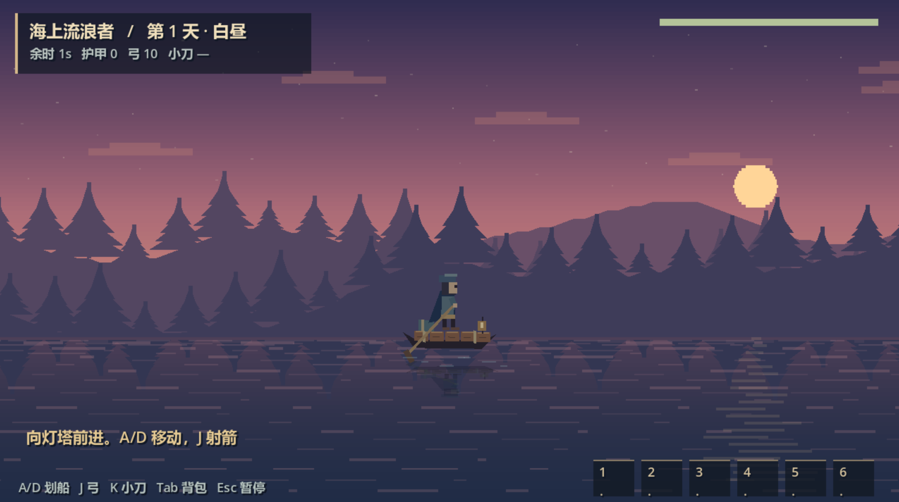
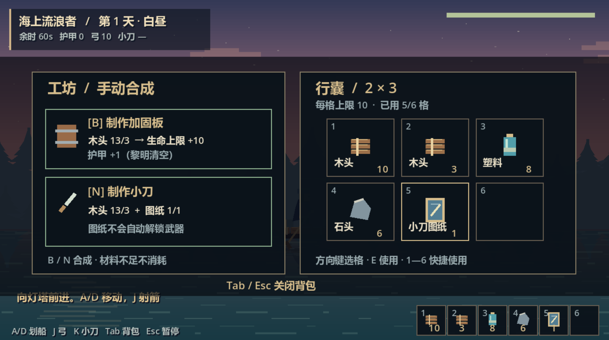

# 《游戏名》游戏设计文档（GDD）v0.2

**版本：** v0.2
**日期：** 2026-11-08
**作者/团队：** XMR

**创作说明：** 我们参考了《王国：两位君主》的美术风格与《星露谷物语》的游戏逻辑，结合两者的设计理念和艺术风格，编写了自己的策划方案，并制作出第一版最小可玩循环。预计于 2026 年 12 月初完成整个游戏的设计。
**比赛名称：** AI 游戏创作大赛
**文档用途：** 团队对齐、AI 生成规格约束、范围控制、提交说明。

------

## 0. 一页纸摘要

- **一句话介绍：** 玩家在 10 天内通过采集建造、分配居民岗位、选择科技路线、探索并升级三座岛屿，完成基地重建；夜晚主动或自动防御敌人，最终让所有岛屿满级并具备自动防御能力。
- **类型：** 短周期基地防御 / 采集建造 / 居民调度 / 科技取舍。
- **平台：** WebGL / Windows（以比赛要求为准）。
- **单局目标时长：** 30—45 分钟；10 天，每天 4—6 分钟；白天可按键提前结束。
- **核心体验：** 科技长期规划 vs 居民即时调度；资源生产 vs 防御投入；主动防御 vs 自动防御的成本与信赖取舍。
- **比赛版范围：** 3 座岛；主岛 1→4 级，副岛解锁 1 级、各 1→2 级；10 天 + 最多 2 天延长；三类居民；三支科技；自动防御中后期解锁。
- **明确不做：** 居民好感/需求/死亡、复杂剧情、天气、多岛夜晚双线实时操作、开放世界、复杂科技树。

------

## 2. 游戏创意与定位

### 2.1 背景与主题

- 世界观一句话：海潮吞没了旧日家园，幸存者乘木筏穿行于被诅咒的群岛，在白昼打捞物资、重建聚落，并于夜晚抵御海雾中的怪物，携手点亮连接三岛的希望之光。

### 2.2 玩家幻想

- 玩家扮演：基地重建的指挥者与守护者。
- 玩家想获得的感觉：在有限时间内做取舍，看到岛屿从破败到满级、从手动防守到自动防御的成长。
- 灵感来源：星露谷（采集/短成长感）+ 王国两位君主（基地扩张/波次防御）。

### 2.3 设计支柱

1. 白天准备，夜晚防御，节奏清晰。
2. 科技长期规划 vs 居民即时调度。
3. 资源生产与防御投入必须取舍。
4. 主动防御有更高信赖收益；自动防御省操作但有维护成本和风险。
5. 每座岛都有可见成长，最终全岛满级并自动防御达标。

### 2.4 反支柱

- 不做居民好感、需求、死亡。
- 不做多岛夜晚双线实时操作。
- 不做复杂剧情和开放世界。
- 不在第 3 周后新增系统。

### 2.5 策略重心与专精

玩家可在“科技重心 / 居民重心 / 混合”之间动态倾斜，但切换有成本。

- **科技重心：** 研究速度 +20%，自动化采集更强；居民防御效率 -15%，夜晚更依赖建筑和玩家操作。
- **居民重心：** 居民采集与防御效率 +20%；研究速度 -15%，科技解锁慢。
- **混合：** 无专精奖励，但短板少、容错高。
- **全押限制：** 全科技或全居民理论可通关，但容错低，需要更优研究顺序、岗位调度和建筑布局；不硬锁路线。

------

## 3. 核心玩法循环

### 3.1 一句话核心循环

白天采集资源 → 分配居民岗位 → 选择研究/建造/探索 → 黄昏预警 → 夜晚主动或自动防御 → 结算 → 进入下一天。

### 3.2 循环拆解

| 阶段 | 玩家做什么                               | 系统反馈                       | 时长     |
| :--- | :--------------------------------------- | :----------------------------- | :------- |
| 白天 | 采集、建造、分配居民、选择科技、切换岛屿 | 资源/研究点变化、居民工作反馈  | 2—3 分钟 |
| 黄昏 | 查看今晚威胁，最后调整居民与防御         | 预警 UI、音效                  | 20—30 秒 |
| 夜晚 | 主动防御或自动结算；塔自动攻击、居民协助 | 受击、击杀、基地血量、维护消耗 | 1—2 分钟 |
| 结算 | 查看损失、居民状态、研究进度、维护消耗   | 结算面板                       | 20 秒    |

### 3.3 胜负条件

- **立即胜利：** 所有岛满级且所有岛自动防御达标，立即胜利。
	- 主岛 4 级；两个副岛各 2 级。
- **第 10 天结算：** 若未立即胜利：
	- 主岛满级且主岛自动防御达标，且所有副岛至少 1 级 → 延长 2 天。
	- 否则失败。
- **延长期间：** 波次增强；可继续升级和建设自动防御；延长结束仍未全达标则失败。
- **失败：** 主岛核心 HP 归零；或延长结束仍未满足全岛满级 + 自动防御达标。
- **重开：** 胜负后一键重开。

------

## 4. 单局流程与状态机

状态：`Day → Dusk → Night → Result → NextDay / GameOver / Victory / Extension`

| 状态      | 进入条件                         | 主要行为                             | 退出条件               |
| :-------- | :------------------------------- | :----------------------------------- | :--------------------- |
| Day       | 新一天开始                       | 采集、建造、居民岗位、科技、岛屿切换 | 计时结束或玩家按键     |
| Dusk      | 白天结束                         | 显示今晚波次、威胁方向、自动防御预估 | 倒计时结束             |
| Night     | 黄昏结束                         | 主动战斗或自动结算                   | 波次清空或基地毁       |
| Result    | 夜晚结束                         | 结算资源、维护、居民状态             | 玩家确认               |
| NextDay   | 结算确认                         | 天数 +1                              | 进入 Day               |
| Extension | 第 10 天未立即胜利但满足延长条件 | 延长 2 天，波次增强                  | 达标胜利或延长结束失败 |
| GameOver  | 主岛核心 HP=0 或延长失败         | 失败面板                             | 重开                   |
| Victory   | 全岛满级且自动防御达标           | 胜利面板                             | 重开/退出              |

------

## 5. 系统设计

### 5.1 玩家与交互

- 移动方式：仅沿 x 轴左右移动；键盘 A/D 或 ←/→；移速 120 px/s；转身硬直 0.1 s；攻击时移速 ×0.7。
- 采集方式：收集水面漂浮物资和怪物掉落；背包满时无法拾取并提示“背包已满”；木头、塑料、石头可随时消耗。
- 攻击方式：J 射箭、K 挥刀；方向为最后移动方向；前摇期间不可再次攻击；初始携带弓，小刀通过图纸解锁。
- 建造/拆除方式：
- 交互提示：Tab 打开背包/合成；Esc 暂停（含重开）；仅键盘操作。撞礁石不扣血但船体抖动；屏幕外 100 px 内来敌显示边缘脉冲箭头。
- 玩家 HP/死亡规则：初始生命 100，上限 150；受击无敌 0.6 s，期间不扣血但仍击退 40 px；生命 ≤0 时停帧 0.5 s，再显示失败结算，可重开。
- 前两晚教学：不开放居民主动技能和自动岗位，玩家手动采集、建造、战斗；第 3 天起启用居民岗位与技能。

### 5.2 资源与库存

- 资源：木材、石料、食物、研究点、维护资源。
- 获取：采集、居民岗位、副岛特产、科技加成。
- 消耗：建造、升级、居民维护、自动防御维护、修复。
- 库存上限：小上限，逼玩家取舍。
- 资源点分布：近处安全少，远处多但风险高。

### 5.3 建造系统

| 建筑          | 消耗          | HP   | 功能           | 升级       |
| :------------ | :------------ | :--- | :------------- | :--------- |
| 基地核心      | 不可建        | 100  | 失败条件       | 随基地等级 |
| 城墙          | 10 木         | 50   | 阻挡敌人       | 2 级       |
| 防御塔        | 20 木 + 10 石 | 60   | 自动索敌       | 2 级       |
| 路障          | 5 木          | 30   | 减速/阻挡      | 无         |
| 居民岗位建筑  | 15 木         | 40   | 驻守岗位       | 无         |
| 科技/民生建筑 | 20 木 + 10 石 | 50   | 研究/信赖/交通 | 无         |

- 放置规则：网格/吸附；非法位置提示。
- 拆除返还规则：
- 建造反馈：

### 5.4 敌人与波次

| 敌人 | HP   | 伤害 | 速度 | 行为                              |
| :--- | :--- | :--- | :--- | :-------------------------------- |
| 普通 | 30   | 5    | 中   | 走向基地，遇墙攻墙                |
| 快速 | 20   | 4    | 高   | 优先绕后/冲基地                   |
| 高血 | 80   | 10   | 低   | 攻击建筑                          |
| 精英 | 150  | 15   | 中   | 第 5 晚后出现；自动防御需额外评分 |

- 生成入口：每岛 1—2 个固定入口。
- 寻路：路点 + 遇障碍攻击；第一版不做复杂 A*。
- 波次：第 1—2 晚极低；第 3 天起逐步提升；第 10 天和延长期间明显增强。

### 5.5 战斗与防御

- 塔：射程、攻速、伤害、索敌优先级。
- 玩家：近战/远程、冷却、受击反馈。
- 城墙：被攻击、破坏、修复。
- 居民战斗类：驻守岗位、自动攻击、主动技能。
- 反馈：伤害数字、命中特效、音效、基地受击红闪。

### 5.6 UI 与反馈

- 资源栏、天数/阶段、基地 HP、波次倒计时、敌人方向。
- 建造菜单、居民面板、科技树、岛屿切换、自动防御预估。
- 居民提醒：缺什么维护资源、哪座设施需要手动修复。
- 受击红闪、塔攻击线、建造成功/失败提示、胜负结算。
- 最小教程：前两晚箭头引导采集、建造、战斗。

### 5.7 居民系统

**类别：** 资源收集、建造生产、战斗。
**成长：** 居民等级 = 居民信赖/熟练度，不再做独立等级。
**解锁：** 主岛初期只有建造生产类；第 3 天解锁船只和第一副岛，解锁一种居民；第 4—5 天全种类解锁。
**比赛版居民池建议：** 6 名，每类 2 名【待确认】。
**岗位：** 采集、研究、防御、建造/修理、驻守自动防御。
**规则：** 自动工作；每人 1 被动 + 1 主动技能；受伤次日恢复；不做死亡；每日消耗食物。

| 居民   | 类别          | 被动            | 主动技能              | 维护      |
| :----- | :------------ | :-------------- | :-------------------- | :-------- |
| 建造工 | 建造生产      | 建造消耗 -10%   | 快速修复一段城墙      | 1 食物/天 |
| 工匠   | 建造生产      | 升级速度 +10%   | 短时建造加速          | 1 食物/天 |
| 采集者 | 资源收集      | 木材/石料 +20%  | 短时采集加速          | 1 食物/天 |
| 研究员 | 资源收集/民生 | 研究点 +1/天    | 瞬间完成 10% 当前研究 | 1 食物/天 |
| 守卫   | 战斗          | 夜晚自动攻击    | 短时提升附近塔攻速    | 1 食物/天 |
| 战士   | 战斗          | 对精英伤害 +15% | 短时嘲讽/击退         | 1 食物/天 |

- 未驻守岛：夜晚由居民自动结算；自动防御未解锁时，未驻守岛按基础守卫结算，风险高。
- 居民信赖：岗位工作、民生建筑、主动防御、科技提升；影响效率、技能和自动防御评分。

### 5.8 科技系统

**分支：** 战斗、资源获取、民生（居民信赖建筑 + 岛屿往来交通）。
**比赛版节点：** 9—12 个，三支各 3—4 个，交叉节点 2 个。
**研究：** 消耗研究点 + 白天时间；部分节点需要对应居民岗位。

| 分支 | 示例节点     | 效果                             | 前置                    |
| :--- | :----------- | :------------------------------- | :---------------------- |
| 战斗 | 塔强化 I     | 塔伤害 +20%                      | 无                      |
| 战斗 | 预警系统     | 黄昏显示更多波次信息             | 无                      |
| 战斗 | 自动防御协议 | 解锁自动防御评分与结算           | 主岛 3 级 + 民生前置    |
| 资源 | 自动采集 I   | 居民采集 +15%                    | 无                      |
| 资源 | 研究加速     | 研究速度 +20%                    | 自动采集 I              |
| 资源 | 资源上限     | 库存 +50                         | 无                      |
| 民生 | 信赖建筑     | 居民信赖获取 +20%                | 无                      |
| 民生 | 交通调度     | 岛屿切换时间 -30%，运输上限 +20% | 无                      |
| 民生 | 维护优化     | 自动防御维护消耗 -15%            | 交通调度                |
| 交叉 | 居民研究站   | 研究者研究点 +1/天               | 需研究者岗位            |
| 交叉 | 防御调度     | 守卫技能冷却 -20%                | 需守卫岗位              |
| 交叉 | 全岛协议     | 自动防御评分 +10%                | 自动防御协议 + 信赖建筑 |

- 全科技流：研究快，防御弱，需要建筑和玩家补位。
- 全居民流：采集/防御强，研究慢，自动防御解锁晚。
- 混合流：最稳，但上限低。

### 5.9 岛屿与基地重建

| 岛屿   | 基地等级 | 资源          | 居民解锁       | 威胁        | 解锁        |
| :----- | :------- | :------------ | :------------- | :---------- | :---------- |
| 主岛   | 1→4      | 木材/石料     | 建造生产       | 每晚波次    | 初始        |
| 副岛 A | 1→2      | 食物/研究点   | 资源收集或战斗 | 第 3 晚起   | 第 3 天船只 |
| 副岛 B | 1→2      | 石料/维护资源 | 资源收集或战斗 | 第 4—5 晚起 | 第 3—5 天   |

- 第一次解锁副岛：两个副岛均进入可解锁状态；玩家可任选其一登陆，首次登陆岛解锁对应居民种类；另一岛随后解锁【待确认：一次选一个还是两个都开】。
- 副岛升级条件比主岛更容易。
- 资源共享；岛屿切换消耗白天时间；交通科技降低切换时间、提高运输上限。
- 自动防御中后期解锁：建议条件为主岛 3 级 + 科技“自动防御协议” + 对应岛驻守岗位【待确认】。
- 自动防御可处理常规波次和精英波，但必须满足 5.10 条件。
- 未驻守岛：自动防御解锁后由居民自动结算；未解锁时按基础守卫结算，风险高。

### 5.10 自动防御规则

**前置条件：**

1. 对应岛屿有驻守居民岗位。
2. 当日维护资源足够支付基础维护。
3. 达到防御条件。

**防御条件（比赛版采用评分制，非防御设施无损为硬条件）：**

- 防御评分 = 防御建筑分 + 驻守居民分 + 科技/民生加成 + 自动防御协议。
- 自动防御成功：防御评分 ≥ 当晚波次强度，且非防御设施（基地核心、资源建筑、居民住房）未受损。
- 防御设施受损不影响成功，但计入次日修复费。
- 次日消耗维护资源自动恢复防御设施；资源不够则需玩家手动修复，居民提醒缺什么资源。
- 精英波：防御评分需 ≥ 波次强度 + 精英阈值，否则自动防御失败或高风险。
- 维护消耗 = 基础维护 + 防御设施修复费；可由民生科技折扣。
- 奖励：资源奖励与主动防御相同；居民信赖奖励减少（建议 50%）【待确认】。
- 失败：资源损失、建筑受损、居民受伤；主岛核心归零才游戏失败。副岛自动防御失败不直接游戏失败，但损失资源和进度。

**主动防御优势建议：** 额外研究点、居民信赖、维护折扣或减少修复费；否则自动防御可能架空夜晚玩法。

### 5.11 自动防御与主动防御对比

| 项目     | 主动防御     | 自动防御                     |
| :------- | :----------- | :--------------------------- |
| 操作     | 玩家实时战斗 | 居民驻守自动结算             |
| 奖励     | 资源相同     | 资源相同                     |
| 居民信赖 | 高           | 减少                         |
| 维护成本 | 低/无        | 基础维护 + 修复费            |
| 风险     | 玩家操作风险 | 评分不足/精英波风险          |
| 精英波   | 可处理       | 需满足额外评分               |
| 失败后果 | 基地毁则失败 | 资源损失、建筑受损、居民受伤 |

------

## 6. 内容与数值表

以下已填写数值来自首版最小可玩循环提示词；未提及的完整游戏数值保持空白。

- 地图尺寸：2400 × 360 px；左右各 80 px 为不可通行礁石区；基准视口 640 × 360，窗口 1280 × 720。
- 资源点数量与刷新：木头每 10 s 刷新 1 个，每个白天共 6 个；塑料每 15 s 刷新 1 个，每个白天共 4 个，与木头错开；在礁石区之间随机 x 位置生成；存在 20 s 后消失；某类达上限后停止生成并改刷另一类。
- 建筑数值表：
- 敌人波次表：

| 夜晚 | 波次 | 敌人 | 方向 | 波次间隔 |
| --- | --- | --- | --- | --- |
| 第 1 夜 | 1 / 2 / 3 / 4 | 每波 2 小怪，共 8 只 | 左 / 右 / 左 / 右 | 12 s |
| 第 2 夜 | 1 | 2 小怪 | 左 | 12 s |
| 第 2 夜 | 2 | 2 小怪 | 右 | 12 s |
| 第 2 夜 | 3 | 2 小怪 + 1 大怪 | 左 | 12 s |
| 第 2 夜 | 4 | 3 小怪 + 2 大怪 | 右 | 12 s |

第 2 夜共 9 小怪 + 3 大怪。第 1 夜随机指定 1 只小怪掉落小刀图纸；若未击杀，清场时补发。

| 敌人 | 生命 | 移速 | 接触伤害 | 攻击间隔 |
| --- | --- | --- | --- | --- |
| 小怪 | 20 | 72 px/s | 6 | 1.2 s |
| 大怪 | 60 | 66 px/s | 10 | 1.5 s |

- 科技成本表：
- 居民信赖曲线：
- 基地升级条件：
- 维护资源公式：

### 首版 Demo 其他已明确数值

| 项目 | 数值 |
| --- | --- |
| 玩家生命 | 初始 100，上限 150 |
| 移速 / 攻击时移速 | 120 px/s / ×0.7 |
| 受击无敌 / 击退 / 转身硬直 | 0.6 s / 40 px / 0.1 s |
| 弓 | 伤害 10；间隔 1.0 s；前摇 0.15 s；射程 240 px；箭速 480 px/s；不穿透 |
| 小刀 | 伤害 20；间隔 0.8 s；前摇 0.10 s；射程 32 px；命中后 0.2 s 内不重复判定 |
| 木头 / 塑料 / 石头 | 木头：最大生命 +5 并回复 5；塑料：攻击 +2，累计最多 +10；石头：回复 20 生命 |
| 怪物普通掉落 | 木头 / 石头各 50% |
| 背包 | 6 格；每件 1 格，不堆叠（提示词初版规则） |
| 加固板合成 | 3 木头；最大生命 +10，护甲 +1 |
| 小刀图纸合成 | 3 木头，解锁小刀（提示词初版规则） |
| 护甲 | 每层减免 20% 接触伤害，最多 3 层，每天黎明清空 |
| 昼夜 | 白天 60 s；黄昏 3 s；夜晚 ≤90 s，清场立即结束；黎明 3 s |
| 局长 | 两天两夜，约 4 分 30 秒 |
| 反馈 | 屏幕外 100 px 内敌人触发边缘箭头；敌人受击击退 8 px；死亡停帧 0.5 s |

- 难度曲线：前两晚极低；第 3 天起提升；第 10 天和延长期间增强。
- 经济目标：白天资源只够“经济或防御”二选一；副岛升级更容易。

**验收标准：** 前 3 晚可通关，第 4—5 晚有明显压力但不不可战胜；自动防御可行但非无脑最优。

------

## 7. 美术、音频与呈现

- 视角：2D 俯视 / 横版 / 其他。
- 风格关键词：
- 配色板/参考图：固定 1—2 张风格锚点。
- 分辨率/像素规格：
- UI 风格：
- 音效清单：采集、建造、命中、受击、夜晚警报、自动防御结算、胜利/失败。
- BGM：1—2 条氛围音。
- 动画需求：移动、攻击、受击、建造、居民工作。

**验收标准：** 风格统一，无版权风险，关键反馈有声音。

------

## 8. AI 工具与工作流

| 工具     | 用途                 | 使用阶段  | 人工把关             | 合规记录        |
| :------- | :------------------- | :-------- | :------------------- | :-------------- |
| 代码助手 | 原型代码/报错排查    | 第 1—3 周 | 核心逻辑人工审查     | 记录对话/版本   |
| 图像工具 | 概念图/占位/正式素材 | 第 1—3 周 | 统一风格、去背、修边 | 记录提示词/来源 |
| 音频工具 | 音效/BGM             | 第 2—3 周 | 筛选与剪辑           | 许可证确认      |
| 文本工具 | 文档/测试清单/说明   | 全程      | 人工修改             | 记录用途        |
| 项目管理 | 任务拆解/测试用例    | 全程      | 人工确认             | —               |

- **AI 使用原则：** AI 生成初稿，人类定标准、做筛选、改结果；不直接生成受版权保护角色。
- **AI 可执行规格：** 状态机、数据表、接口说明、目录结构、禁止事项写入 `AGENTS.md/CLAUDE.md`。
- **AI 声明：** 每批素材记录工具、提示词、修改内容、许可证。

------

## 9. 范围与砍功能清单

### P0 必做

- 3 岛；主岛 1→4；副岛各 1→2。
- 10 天 + 最多 2 天延长。
- 昼夜状态机、玩家移动/采集/建造/战斗。
- 三类居民、6 名居民池【待确认】、岗位与信赖。
- 三支科技、9—12 节点。
- 木材/石料/食物/研究点/维护资源。
- 基地核心、城墙、塔、路障、居民岗位建筑、科技/民生建筑。
- 3 种常规敌人 + 精英。
- 主动防御、自动防御评分与结算。
- 胜利/延长/失败/重开。
- 基础 UI、居民提醒、自动防御预估。
- 前两晚教程。

### P1 可选

- 第 3 种敌人变体。
- 居民技能升级。
- 更多科技节点。
- 更精细的自动防御动画。
- 快速模式/5 天演示模式。

### P2 砍掉

- 居民好感/需求/死亡。
- 复杂科技树。
- 多岛夜晚双线实时防守。
- 剧情、天气、复杂经济。
- 开放世界。

------

## 10. 技术方案

- 引擎/版本：Godot 4.x，GDScript；现有 Demo 工程声明兼容 Godot 4.7，工程说明记录使用 Godot 4.7.2 完成导入和运行检查。
- 目录结构：以 `sea_drifter/` 为工程根目录；`project.godot` 为项目配置，`config.json` 存放平衡与视觉参数；`main.tscn/main.gd` 管理主场景和昼夜流程；`boat`、`enemy`、`arrow`、`loot` 分别管理玩家、敌人、箭矢和掉落；`hud`、`inventory_view.gd`、`result` 管理 HUD、背包与结算；`game_state.gd` 为 Autoload 全局状态；`seascape.gd` 绘制环境；测试脚本包含 `smoke_test.gd`、`inventory_test.gd`、`animation_test.gd`；`docs/` 存放策划与图片，`downloads/` 存放工程下载包。
- 版本管理：Git + 每日构建。
- 构建/打包：当前以 ZIP 形式分发 Godot 工程；解压后用 Godot 打开 `project.godot`，按 F5 运行。Windows/WebGL 独立导出配置：
- 性能目标：基准分辨率 640 × 360，默认窗口 1280 × 720；采用 Compatibility 渲染、Nearest 纹理过滤，关闭抗锯齿与相机位置平滑。目标帧率及硬件指标：
- 已知技术风险：现有 Demo 尚未完成完整一局的人工操作验收；音频节点仍为空占位；原始提示词与现有实现的背包/小刀规则存在版本差异，后续需统一；配置中的固定阶段时长与清场立即结束机制不能保证单局精确为 4 分 30 秒；部分绘制与视觉常量仍在脚本中，尚未全部参数化。三岛、居民、科技及自动防御属于完整游戏规划，尚需后续实现和集成验证。
- 回退版本策略：

------

## 11. 里程碑与周计划

| 周      | 目标                                          | 交付物                                   | 验收                               |
| :------ | :-------------------------------------------- | :--------------------------------------- | :--------------------------------- |
| 第 1 周 | 规格冻结 + 单岛白盒 + 前两晚手动流程          | GDD、状态机、玩家采集/建造/战斗、基础 UI | 能完成一次白天—夜晚—结算           |
| 第 2 周 | 第二/第三岛、居民三类、科技三支、自动防御评分 | 岛屿切换、居民岗位、科技树、自动防御原型 | 自动防御可结算，维护资源可扣       |
| 第 3 周 | 集成、外部测试、调自动/主动平衡、延长条件     | 3—5 分钟垂直切片→完整 10 天流程          | 陌生人能理解居民/科技/自动防御差异 |
| 第 4 周 | 修阻塞 bug、包装、AI 声明、提交               | 可玩包、封面、截图、视频、AI 声明        | 提前 48 小时提交并无痕验证         |

------

## 12. 测试计划

- 内部测试：每日构建自测。
- 外部测试：第 3 周找 3—5 名陌生人，不先教学。
- 重点观察：
	- 前两晚是否太无聊。
	- 第 3 天是否知道去哪个副岛、解锁什么居民。
	- 自动防御是否架空主动防御。
	- 三岛同时自动防御时居民岗位是否够。
	- 第 10 天延长条件是否挫败。
- Bug 分级：阻塞/严重/一般/体验。
- 测试记录表：日期、版本、测试者、卡点、修改。

------

## 13. 风险与应对

| 风险                          | 概率 | 影响 | 应对                                          |
| :---------------------------- | :--- | :--- | :-------------------------------------------- |
| 范围膨胀                      | 高   | 高   | 第 3 周冻结功能；先做单岛再扩三岛             |
| 自动防御架空主动防御          | 高   | 高   | 维护成本、精英波阈值、主动防御额外信赖/研究点 |
| 第 3 天去副岛后主岛夜晚无人守 | 高   | 高   | 明确夜晚驻守规则或第 3—5 天强制回主岛         |
| 三岛自动防御居民不够          | 中高 | 高   | 居民池 6 名；岗位槽和调动时间明确             |
| 10 天单局过长                 | 中   | 中   | 白天可跳过；提供快速模式/5 天演示             |
| 延长 2 天不够                 | 中   | 高   | 降低副岛 2 级条件或延长 3 天                  |
| AI 素材风格不一致             | 高   | 中   | 第 1 周锁风格锚点                             |
| 提交链接/包体问题             | 中   | 高   | 提前 48h 提交并无痕验证                       |

------

## 14. 提交物清单

- □ 

	可玩链接/包体（公开可访问）

- □ 

	封面图

- □ 

	3—5 张截图

- □ 

	操作说明

- □ 

	30—60 秒演示视频

- □ 

	参赛构想帖子链接

- □ 

	AI 使用声明与工具记录

- □ 

	团队信息

- □ 

	无痕窗口验证通过

------

## 附录 A：AI 可执行规格附加页

- 状态机伪代码：
- 数据表字段定义：
- 模块接口：
- 目录结构与命名规范：
- 禁止 AI 修改的文件/系统：
- 每次生成后的验收清单：

## 附录 B：开发日志

| 日期 | 完成 | 问题 | 下一步 | AI 工具/提示词记录 |
| :--- | :--- | :--- | :----- | :----------------- |
|      |      |      |        |                    |

## Demo 截图与下载

以下展示初期测试的最小可玩循环，完整游戏规划以策划方案为准。

[下载 Demo Godot 工程包](../downloads/Sea_Drifter_Demo.zip)，使用 Godot 4 打开 project.godot 运行。

---

# English Version

# Game Design Document (GDD) v0.2 — [Game Title]

**Version:** v0.2  
**Date:** 2026-11-08  
**Author / Team:** XMR  

**Creative statement:** Drawing inspiration from the art style of Kingdom Two Crowns and the gameplay logic of Stardew Valley, we combined their design philosophies and artistic influences to develop our own design plan and build the first minimum playable loop. We expect to complete the design of the entire game in early December 2026.
**Competition:** AI Game Creation Competition  
**Purpose:** Team alignment, constraints for AI-generated specifications, scope control, and submission documentation.

---

## 0. One-Page Summary

- **Pitch:** Within 10 days, gather resources, build, assign residents, choose technologies, and explore and upgrade three islands to rebuild their bases. Defend against enemies at night through active combat or automatic defense, ultimately maximizing every island and meeting its automatic-defense requirements.
- **Genre:** Short-session base defense / gathering and construction / resident assignment / technology trade-offs.
- **Platforms:** WebGL / Windows, subject to competition requirements.
- **Target session length:** 30–45 minutes; 10 days lasting 4–6 minutes each. Players may end daytime early.
- **Core experience:** Long-term technology planning versus immediate resident assignment; production versus defense; active versus automatic defense, balancing costs and resident trust.
- **Competition scope:** Three islands; main island levels 1–4; secondary islands unlocked at level 1 and upgraded to level 2; 10 days plus up to 2 extension days; three resident categories; three technology branches; automatic defense unlocked in the middle or late game.
- **Out of scope:** Resident affection, needs or death; complex story; weather; simultaneous real-time nighttime control on multiple islands; open world; complex technology trees.

## 2. Concept and Positioning

### 2.1 Setting and Theme
- One-sentence setting: After the tides swallow their homeland, survivors travel by raft through cursed islands, salvage supplies and rebuild settlements by day, and fight monsters in the sea fog by night to rekindle hope across three islands.

### 2.2 Player Fantasy
- Role: Commander and protector overseeing base reconstruction.
- Desired feeling: Make trade-offs under time pressure and watch ruined islands develop into fully upgraded, automatically defended settlements.
- Inspirations: Stardew Valley for gathering and short progression loops; Kingdom Two Crowns for base expansion and wave defense.

### 2.3 Design Pillars
1. Prepare by day and defend by night, with a clear rhythm.
2. Balance long-term technology planning with immediate resident assignment.
3. Require trade-offs between production and defense.
4. Active defense earns more trust; automatic defense reduces input but introduces upkeep and risk.
5. Show visible growth on every island, culminating in maximum levels and adequate automatic defense.

### 2.4 Anti-Pillars
- No resident affection, needs or death.
- No simultaneous real-time nighttime control across multiple islands.
- No complex story or open world.
- No new systems after week 3.

### 2.5 Strategic Focus and Specialization
Players may shift between technology, resident and mixed strategies, at a cost.

- **Technology focus:** Research speed +20%; stronger automated gathering; resident defense efficiency -15%; greater reliance on structures and player combat at night.
- **Resident focus:** Resident gathering and defense efficiency +20%; research speed -15%; slower technology unlocks.
- **Mixed:** No specialization bonus, but fewer weaknesses and greater tolerance for mistakes.
- **All-in limits:** Pure technology and pure resident strategies should both be viable but less forgiving, requiring better research order, assignments and building layouts. Do not hard-lock either route.

## 3. Core Gameplay Loop

### 3.1 Core Loop
Gather during the day → assign residents → choose research, construction or exploration → receive dusk warnings → defend actively or automatically at night → resolve results → start the next day.

### 3.2 Loop Breakdown

| Phase | Player actions | System feedback | Duration |
| --- | --- | --- | --- |
| Day | Gather, build, assign residents, choose technologies, switch islands | Resource and research changes; resident work feedback | 2–3 minutes |
| Dusk | Review threats; make final resident and defense adjustments | Warning UI and audio | 20–30 seconds |
| Night | Active defense or automatic resolution; towers attack and residents assist | Hits, kills, base HP and upkeep use | 1–2 minutes |
| Results | Review losses, resident status, research and upkeep | Results panel | 20 seconds |

### 3.3 Victory and Defeat
- **Immediate victory:** All islands reach maximum level and meet automatic-defense requirements: main island level 4 and both secondary islands level 2.
- **Day 10 results:** If immediate victory has not occurred, grant 2 extension days only if the main island is fully upgraded and meets automatic-defense requirements, and every secondary island is at least level 1. Otherwise, the player loses.
- **Extension:** Stronger waves; upgrades and automatic-defense construction remain available. Failure to meet all requirements by the end results in defeat.
- **Defeat:** Main-island core HP reaches zero, or the extension ends without all islands fully upgraded and meeting automatic-defense requirements.
- **Restart:** One-click restart after victory or defeat.

## 4. Session Flow and State Machine

States: `Day → Dusk → Night → Result → NextDay / GameOver / Victory / Extension`

| State | Entry | Main behavior | Exit |
| --- | --- | --- | --- |
| Day | New day begins | Gathering, building, assignments, research, island travel | Timer expires or player ends day |
| Dusk | Day ends | Show waves, directions and automatic-defense estimate | Countdown ends |
| Night | Dusk ends | Active combat or automatic resolution | Waves cleared or base destroyed |
| Result | Night ends | Resolve resources, upkeep and residents | Player confirms |
| NextDay | Results confirmed | Increment day | Enter Day |
| Extension | Day 10 extension conditions met without victory | Add 2 days with stronger waves | Victory requirements met or extension expires |
| GameOver | Main core HP reaches zero or extension fails | Defeat panel | Restart |
| Victory | All islands maxed and automatic defense adequate | Victory panel | Restart / exit |

## 5. System Design

### 5.1 Player and Interaction
- Movement: Left/right only along the x-axis; A/D or arrow keys; 120 px/s; turn lock 0.1 s; movement while attacking ×0.7.
- Gathering: Collect floating supplies and enemy drops. A full inventory blocks pickup and displays a warning. Wood, plastic and stone can be consumed at any time.
- Attacking: J fires the bow; K swings the knife. Attack in the last movement direction; no new attack during windup. Start with a bow; unlock the knife through a blueprint.
- Building / demolition:
- Interaction prompts: Tab opens inventory/crafting; Esc pauses, with restart available; keyboard only. Reef collisions cause boat shake without damage. Pulse arrows warn of off-screen enemies within 100 px.
- Player HP / death rules: Initially 100 HP, cap 150; hit invulnerability 0.6 s prevents damage but still applies 40 px knockback. At HP ≤0, freeze for 0.5 s, then show defeat results with restart.
- Tutorial: For the first two nights, disable resident active skills and automated assignments; the player gathers, builds and fights manually. Enable resident jobs and skills from day 3.

### 5.2 Resources and Inventory
- Resources: Wood, stone, food, research points and maintenance resources.
- Sources: Gathering, resident jobs, island specialties and technology bonuses.
- Uses: Construction, upgrades, resident upkeep, automatic-defense upkeep and repairs.
- Capacity: Small inventory limits force choices.
- Distribution: Nearby deposits are safer but smaller; distant deposits are richer but riskier.

### 5.3 Construction

| Building | Cost | HP | Function | Upgrade |
| --- | --- | --- | --- | --- |
| Base core | Cannot be built | 100 | Destruction causes defeat | With base level |
| Wall | 10 wood | 50 | Blocks enemies | Level 2 |
| Tower | 20 wood + 10 stone | 60 | Automatic targeting | Level 2 |
| Barricade | 5 wood | 30 | Slows / blocks enemies | None |
| Resident workplace | 15 wood | 40 | Assigned resident post | None |
| Technology / civic building | 20 wood + 10 stone | 50 | Research / trust / transport | None |

- Placement: Grid / snapping with invalid-position feedback.
- Demolition refunds:
- Construction feedback:

### 5.4 Enemies and Waves

| Enemy | HP | Damage | Speed | Behavior |
| --- | --- | --- | --- | --- |
| Standard | 30 | 5 | Medium | Approaches base; attacks walls in its path |
| Fast | 20 | 4 | High | Prioritizes flanking / rushing the base |
| Tank | 80 | 10 | Low | Attacks structures |
| Elite | 150 | 15 | Medium | Appears after night 5; requires additional automatic-defense score |

- Spawns: 1–2 fixed entrances per island.
- Pathfinding: Waypoints and attacks against obstructions; no complex A* in the first version.
- Waves: Very weak on nights 1–2; increase from day 3; substantially stronger on day 10 and during the extension.

### 5.5 Combat and Defense
- Towers: Range, attack speed, damage and targeting priorities.
- Player: Melee / ranged attacks, cooldowns and hit feedback.
- Walls: Damage, destruction and repairs.
- Combat residents: Assigned posts, automatic attacks and active skills.
- Feedback: Damage numbers, hit effects, audio and red flashes when the base is hit.

### 5.6 UI and Feedback
- Resource bar, day / phase, base HP, wave countdown and enemy direction.
- Building menu, resident panel, technology tree, island switching and automatic-defense estimate.
- Resident reminders identify missing maintenance resources and structures needing manual repair.
- Red hit flashes, tower attack lines, construction success / failure messages and end-of-game results.
- Minimal tutorial: Arrows guide gathering, construction and combat during the first two nights.

### 5.7 Residents
**Categories:** Resource gathering, construction / production, combat.  
**Progression:** Resident level is represented by trust / proficiency; no separate level system.  
**Unlocks:** Initially only construction / production residents on the main island. A boat and first secondary island unlock on day 3, adding one category. Unlock all categories by days 4–5.  
**Suggested competition roster:** Six residents, two per category [TBC].  
**Jobs:** Gathering, research, defense, construction / repair and automatic-defense garrison duty.  
**Rules:** Automatic work; one passive and one active skill each; injuries recover the next day; no death; daily food upkeep.

| Resident | Category | Passive | Active skill | Upkeep |
| --- | --- | --- | --- | --- |
| Builder | Construction / production | Construction cost -10% | Quickly repair a wall segment | 1 food/day |
| Artisan | Construction / production | Upgrade speed +10% | Temporary construction speed boost | 1 food/day |
| Gatherer | Resource gathering | Wood / stone +20% | Temporary gathering speed boost | 1 food/day |
| Researcher | Gathering / civic | Research points +1/day | Instantly complete 10% of current research | 1 food/day |
| Guard | Combat | Automatic nighttime attacks | Temporarily increase nearby tower attack speed | 1 food/day |
| Warrior | Combat | Damage against elites +15% | Brief taunt / knockback | 1 food/day |

- Islands without the player: Residents resolve nighttime defense automatically. Before automatic defense is unlocked, use basic-guard resolution with high risk.
- Trust increases through assigned work, civic buildings, active defense and technologies; it affects efficiency, skills and automatic-defense score.

### 5.8 Technology
**Branches:** Combat, resource acquisition, and civic development (trust buildings and inter-island transport).  
**Competition nodes:** 9–12 nodes; 3–4 per branch and 2 cross-branch nodes.  
**Research:** Costs research points and daytime; some nodes require a corresponding resident job.

| Branch | Example node | Effect | Prerequisite |
| --- | --- | --- | --- |
| Combat | Tower Upgrade I | Tower damage +20% | None |
| Combat | Early Warning | More wave information at dusk | None |
| Combat | Automatic Defense Protocol | Unlock defense scoring and resolution | Main island level 3 + civic prerequisite |
| Resources | Automated Gathering I | Resident gathering +15% | None |
| Resources | Research Acceleration | Research speed +20% | Automated Gathering I |
| Resources | Storage Capacity | Inventory +50 | None |
| Civic | Trust Building | Trust gain +20% | None |
| Civic | Transport Scheduling | Island travel time -30%; transport capacity +20% | None |
| Civic | Maintenance Optimization | Automatic-defense upkeep -15% | Transport Scheduling |
| Cross-branch | Resident Research Station | Researcher research points +1/day | Researcher post |
| Cross-branch | Defense Coordination | Guard skill cooldown -20% | Guard post |
| Cross-branch | All-Island Protocol | Automatic-defense score +10% | Automatic Defense Protocol + Trust Building |

- Technology-only: Fast research, weak defense; buildings and player actions must compensate.
- Resident-only: Strong gathering / defense, slow research and later automatic-defense unlock.
- Mixed: Most stable, but lower ceiling.

### 5.9 Islands and Base Reconstruction

| Island | Base levels | Resources | Resident unlock | Threat | Unlock |
| --- | --- | --- | --- | --- | --- |
| Main | 1–4 | Wood / stone | Construction / production | Nightly waves | Initially |
| Secondary A | 1–2 | Food / research points | Gathering or combat | From night 3 | Boat on day 3 |
| Secondary B | 1–2 | Stone / maintenance resources | Gathering or combat | From days 4–5 | Days 3–5 |

- At the first secondary-island unlock, both become eligible. Players may land on either first to unlock its resident category; the other follows [TBC: choose one at a time or unlock both].
- Secondary-island upgrades are easier than main-island upgrades.
- Resources are shared; island travel consumes daytime. Transport technology reduces travel time and raises transport capacity.
- Suggested automatic-defense unlock: Main island level 3 + Automatic Defense Protocol + a garrison post on the relevant island [TBC].
- Automatic defense handles normal and elite waves if section 5.10 requirements are met.
- Islands without the player use resident resolution after unlock; basic-guard resolution before unlock is risky.

### 5.10 Automatic Defense
**Prerequisites:**
1. A resident garrison post on the island.
2. Enough maintenance resources for daily base upkeep.
3. Defense requirements met.

**Defense requirements:** The competition build uses a score system, with no damage to non-defensive structures as a mandatory condition.

- Defense score = defensive-building score + garrison-resident score + technology / civic bonuses + Automatic Defense Protocol.
- Success requires defense score ≥ that night's wave strength, with no damage to non-defensive structures (core, resource buildings and resident housing).
- Damage to defensive structures does not prevent success but adds next-day repair costs.
- Next day, maintenance resources automatically restore defenses. If insufficient, the player repairs manually and residents identify missing resources.
- Elite waves require defense score ≥ wave strength + elite threshold; otherwise resolution fails or is high risk.
- Upkeep = base upkeep + defensive-structure repairs, reduced by civic technologies.
- Rewards: Same resources as active defense, but reduced trust rewards (suggested 50%) [TBC].
- Failure causes resource losses, building damage and resident injuries. Only destruction of the main core causes immediate game defeat. Failure on a secondary island costs resources and progress.

**Suggested active-defense advantages:** Extra research points, trust, upkeep discounts or lower repair costs; otherwise automatic defense may make nighttime gameplay redundant.

### 5.11 Active versus Automatic Defense

| Aspect | Active | Automatic |
| --- | --- | --- |
| Input | Real-time player combat | Resident garrison resolution |
| Resources | Same rewards | Same rewards |
| Trust | Higher | Reduced |
| Upkeep | Low / none | Base upkeep + repairs |
| Risk | Player execution | Insufficient score / elite waves |
| Elite waves | Can be handled | Additional score required |
| Failure | Base destruction causes defeat | Resource loss, building damage, resident injuries |

## 6. Content and Balance Tables

Filled values below come from the first minimum playable loop prompt. Full-game values not specified there remain blank.

- Map dimensions: 2400 × 360 px; an impassable 80 px reef zone at each end; base viewport 640 × 360; window 1280 × 720.
- Resource-deposit count and respawn: One wood every 10 s, six per daytime; one plastic every 15 s, four per daytime, staggered against wood. Random x positions between reefs; despawn after 20 s. When one resource reaches its cap, stop spawning it and spawn the other.
- Building balance table:
- Wave table:

| Night | Wave | Enemies | Direction | Wave interval |
| --- | --- | --- | --- | --- |
| 1 | 1 / 2 / 3 / 4 | Two small enemies each; eight total | Left / right / left / right | 12 s |
| 2 | 1 | Two small | Left | 12 s |
| 2 | 2 | Two small | Right | 12 s |
| 2 | 3 | Two small + one large | Left | 12 s |
| 2 | 4 | Three small + two large | Right | 12 s |

Night 2 totals nine small and three large enemies. One random small enemy on night 1 drops the knife blueprint; award it at wave clearance if that enemy was not killed.

| Enemy | HP | Speed | Contact damage | Attack interval |
| --- | --- | --- | --- | --- |
| Small | 20 | 72 px/s | 6 | 1.2 s |
| Large | 60 | 66 px/s | 10 | 1.5 s |

- Technology costs:
- Resident trust curve:
- Base upgrade requirements:
- Maintenance-resource formula:

### Other Specified First-Demo Values

| Item | Values |
| --- | --- |
| Player HP | Initially 100; cap 150 |
| Movement / attacking movement | 120 px/s / ×0.7 |
| Hit invulnerability / knockback / turn lock | 0.6 s / 40 px / 0.1 s |
| Bow | Damage 10; interval 1.0 s; windup 0.15 s; range 240 px; arrow speed 480 px/s; no piercing |
| Knife | Damage 20; interval 0.8 s; windup 0.10 s; range 32 px; no repeated hit within 0.2 s |
| Wood / plastic / stone | Wood: max HP +5 and heal 5; plastic: attack +2, cumulative cap +10; stone: heal 20 HP |
| Normal enemy drops | Wood / stone, 50% each |
| Inventory | Six slots; one item per slot, no stacking (original prompt rule) |
| Reinforced board | Three wood; max HP +10 and armor +1 |
| Knife blueprint crafting | Three wood; unlock knife (original prompt rule) |
| Armor | Contact damage -20% per layer; maximum three layers; cleared every dawn |
| Phases | Day 60 s; dusk 3 s; night ≤90 s, ends immediately on clearance; dawn 3 s |
| Session | Two days and two nights; approximately 4 minutes 30 seconds |
| Feedback | Edge arrows for off-screen enemies within 100 px; enemy hit knockback 8 px; death freeze 0.5 s |

- Difficulty: Very low for the first two nights; rises from day 3; spikes on day 10 and in the extension.
- Economy: Daytime resources support either economic investment or defense, forcing a choice. Secondary islands are easier to upgrade.

**Acceptance criteria:** First three nights are beatable; nights 4–5 create clear but manageable pressure. Automatic defense is viable without being an obvious, thoughtless optimum.

## 7. Art, Audio and Presentation
- View: 2D top-down / side-scrolling / other.
- Style keywords:
- Palette / references: Fix 1–2 visual anchors.
- Resolution / pixel specifications:
- UI style:
- Sound effects: Gathering, construction, hits, taking damage, nighttime warning, automatic-defense results, victory / defeat.
- Music: 1–2 ambient tracks.
- Animation: Movement, attacks, taking damage, construction and resident work.

**Acceptance criteria:** Consistent style, no copyright risks, and audio for key feedback.

## 8. AI Tools and Workflow

| Tool | Use | Phase | Human review | Records |
| --- | --- | --- | --- | --- |
| Coding assistant | Prototype code / debugging | Weeks 1–3 | Review core logic | Conversations / versions |
| Image tools | Concepts / placeholders / final assets | Weeks 1–3 | Style consistency, background removal, edge cleanup | Prompts / sources |
| Audio tools | Sound effects / music | Weeks 2–3 | Selection and editing | License verification |
| Text tools | Documents / test checklists / instructions | Throughout | Human editing | Purpose |
| Project management | Task breakdown / test cases | Throughout | Human confirmation | — |

- **AI principles:** AI drafts; humans set standards, select and revise. Do not directly generate copyrighted characters.
- **Executable specifications:** Put state machines, tables, interfaces, directories and prohibitions in `AGENTS.md/CLAUDE.md`.
- **Disclosure:** Record tools, prompts, modifications and licenses for each asset batch.

## 9. Scope and Cut List

### P0 — Required
- Three islands; main levels 1–4; secondary islands levels 1–2 each.
- 10 days plus up to 2 extension days.
- Day/night states; movement, gathering, construction and combat.
- Three resident categories; six residents [TBC]; jobs and trust.
- Three technology branches with 9–12 nodes.
- Wood, stone, food, research points and maintenance resources.
- Core, walls, towers, barricades, workplaces, technology / civic buildings.
- Three standard enemy types plus elites.
- Active defense; automatic-defense scoring and resolution.
- Victory, extension, defeat and restart.
- Basic UI, resident reminders and defense estimates.
- Tutorial for the first two nights.

### P1 — Optional
- A third enemy variant.
- Resident skill upgrades.
- More technology nodes.
- More detailed automatic-defense animation.
- Fast mode / five-day demonstration.

### P2 — Cut
- Resident affection, needs and death.
- Complex technology trees.
- Simultaneous real-time nighttime defense across islands.
- Story, weather and complex economy.
- Open world.

## 10. Technical Plan

- Engine / version: Godot 4.x with GDScript. The current demo declares Godot 4.7 compatibility; its README records import and runtime checks using Godot 4.7.2.
- Directory structure: `sea_drifter/` is the project root. `project.godot` contains project settings; `config.json` holds balance and visual parameters. `main.tscn/main.gd` manages the main scene and phase flow. `boat`, `enemy`, `arrow` and `loot` handle the player, enemies, arrows and drops. `hud`, `inventory_view.gd` and `result` handle HUD, inventory and results. `game_state.gd` is the global Autoload; `seascape.gd` draws the environment. Tests include `smoke_test.gd`, `inventory_test.gd` and `animation_test.gd`. `docs/` holds plans and images; `downloads/` holds project archives.
- Version control: Git + daily builds.
- Build / packaging: Currently distributed as a ZIP of the Godot project. Extract it, open `project.godot` in Godot and press F5. Standalone Windows/WebGL export configuration:
- Performance targets: Base resolution 640 × 360; default window 1280 × 720; Compatibility rendering and Nearest texture filtering; antialiasing and camera position smoothing disabled. Target frame rate and hardware specifications:
- Known technical risks: A complete manual playthrough is still pending; audio nodes remain placeholders. Inventory and knife rules differ between the original prompt and current implementation and need reconciliation. Fixed phase durations combined with immediate wave-clear endings cannot guarantee an exact 4-minute-30-second session. Some drawing and visual constants remain in scripts. The three-island, resident, technology and automatic-defense systems remain planned full-game features requiring implementation and integration validation.
- Rollback strategy:

## 11. Milestones and Weekly Plan

| Week | Goal | Deliverables | Acceptance |
| --- | --- | --- | --- |
| 1 | Freeze specifications; single-island graybox; manual first two nights | GDD, state machine, gathering / building / combat, basic UI | Complete one day–night–results cycle |
| 2 | Second and third islands; resident categories; technology branches; defense scoring | Island switching, jobs, tech tree, automatic-defense prototype | Automatic resolution works and deducts upkeep |
| 3 | Integration, external testing, active/automatic balance, extension conditions | 3–5 minute vertical slice → full 10-day loop | New players understand resident, technology and defense differences |
| 4 | Fix blocking bugs, presentation, AI disclosure, submission | Playable build, cover, screenshots, video, disclosure | Submit 48 hours early; verify in an incognito window |

## 12. Test Plan
- Internal: Self-test daily builds.
- External: Recruit 3–5 unfamiliar players in week 3 without explaining the game first.
- Observe whether:
  - The first two nights are too dull.
  - Players know which secondary island to visit and which residents it unlocks on day 3.
  - Automatic defense makes active defense redundant.
  - Enough resident posts exist for automatic defense on all three islands.
  - Day 10 extension requirements feel frustrating.
- Bug severity: Blocking / major / normal / experience.
- Test log: Date, version, tester, sticking point and change.

## 13. Risks and Mitigations

| Risk | Likelihood | Impact | Mitigation |
| --- | --- | --- | --- |
| Scope growth | High | High | Freeze features in week 3; build one island before expanding |
| Automatic defense displaces active defense | High | High | Upkeep, elite thresholds, extra active-defense trust / research |
| Main island undefended after day 3 travel | High | High | Clarify garrison rules or require return on days 3–5 |
| Too few residents for all-island automatic defense | Medium-high | High | Six residents; explicit post slots and reassignment time |
| Ten-day sessions too long | Medium | Medium | Skip daytime; fast mode / five-day demo |
| Two extension days insufficient | Medium | High | Ease secondary level-2 requirements or extend to three days |
| Inconsistent AI art | High | Medium | Fix visual anchors in week 1 |
| Submission link / build problems | Medium | High | Submit 48 hours early; verify incognito access |

## 14. Submission Checklist
- [ ] Publicly accessible playable link / build
- [ ] Cover image
- [ ] 3–5 screenshots
- [ ] Controls
- [ ] 30–60 second demonstration video
- [ ] Competition concept-post link
- [ ] AI-use disclosure and tool records
- [ ] Team information
- [ ] Incognito verification passed

## Appendix A. AI-Executable Specification Addendum
- State-machine pseudocode:
- Data-table fields:
- Module interfaces:
- Directory structure and naming:
- Files / systems AI must not modify:
- Acceptance checklist after each generation:

## Appendix B. Development Log

| Date | Completed | Issues | Next steps | AI tools / prompt records |
| --- | --- | --- | --- | --- |
| | | | | |

## Prototype Screenshots

These screenshots show the early minimum playable loop prototype, rather than the full planned game.

[Download the Godot demo project](../downloads/Sea_Drifter_Demo.zip). Open project.godot in Godot 4 to run.
